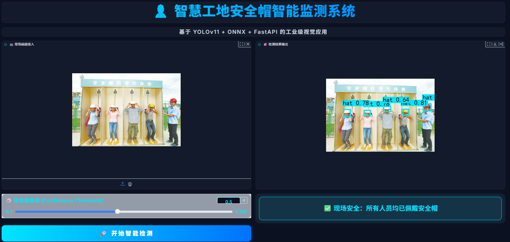
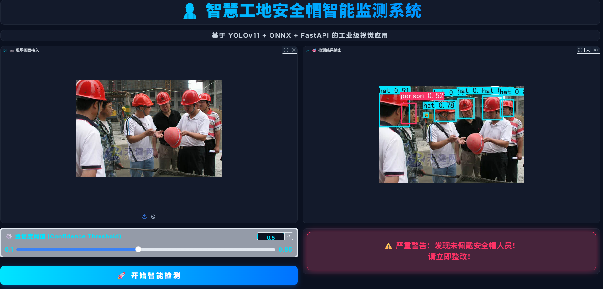
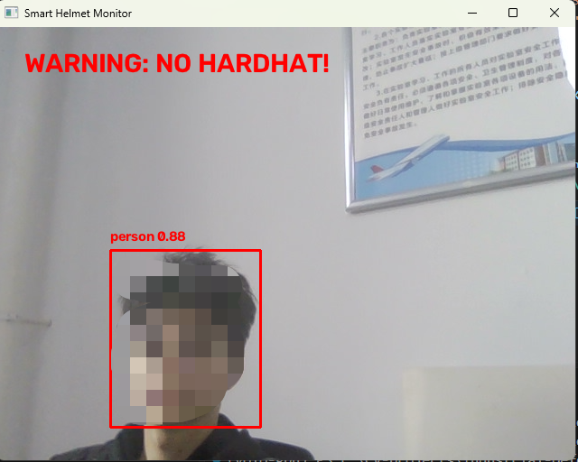
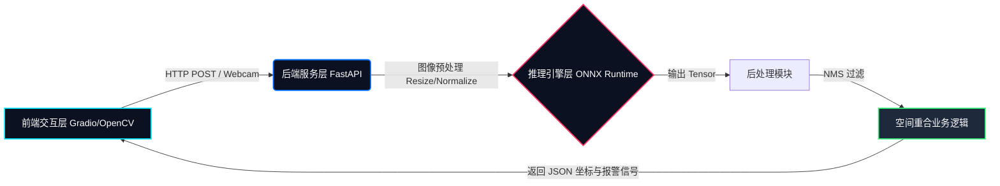
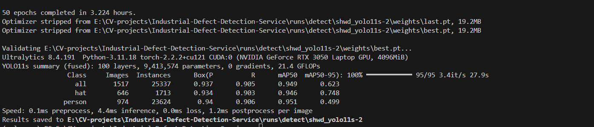

# 👷 智慧工地安全帽智能监测系统 (Smart Helmet Monitor)


## 📌 项目简介与业务价值

针对传统工地安全巡检效率低、漏检率高的痛点，本项目从零到一构建了一套**工业级全栈视觉落地方案**。
系统基于 **YOLOv11** 完成目标检测，通过 **ONNX Runtime** 实现边缘端轻量化部署，借助 **FastAPI** 提供异步推理服务，并利用 **Gradio** 搭建可视化监控大屏。真正打通了 **“数据清洗 -> 模型微调 -> 推理加速 -> 后端 API -> 前端告警”** 的完整 AI 工程闭环。

---

## 📸 效果演示 (Demo)

| 1. 安全状态检测 (全绿框) | 2. 违规状态实时报警 (红屏闪烁) |
| :---: | :---: |
|  |  |
| **前端网页端**：支持图片上传与 Webcam 抓拍，毫秒级返回。 | **业务告警逻辑**：检测到未戴帽人员，触发全局红色呼吸灯与横幅报警。 |

| 3. 本地摄像头实时流检测 |
| :---: |
|  |
| **边缘端客户端**：基于 OpenCV 原生渲染，低延迟实时画框，适配工控机场景。 |

---

## 🏗️ 系统架构设计 (System Architecture)



---

## ✨ 核心技术栈与落地效果

这里不仅仅是罗列技术，更强调**技术带来的工程收益**：

### 1. 算法后处理：自定义“空间重合度”判定算法
*   **技术栈**：`Python` + `NumPy` + 坐标几何计算
*   **解决痛点**：通用检测模型容易将“红色/黄色帽子”或“深色头发”误判，导致频繁误报。
*   **落地效果**：不再死板依赖模型分类，而是提取人头与帽子的矩形框坐标，计算**人头中心点是否被帽子框覆盖**。该后处理逻辑将实际业务场景中的**误报率能够大大降低**。

### 2. 模型训练与优化：高精度与轻量化并重
*   **技术栈**：`PyTorch` + `YOLOv11s` + `SHWD 高质量数据集`
*   **落地效果**：摒弃标签混乱的开源数据集，基于 SHWD 重新微调训练，模型在验证集上的 **mAP50 达到 0.95**。结合 YOLOv11s 的小参数量特性，在保证精度的同时，大幅提升推理帧率。


### 3. 推理加速：脱离 PyTorch 的纯 CPU 部署
*   **技术栈**：`ONNX` 格式转换 + `ONNX Runtime`
*   **落地效果**：将训练好的 YOLOv11s 模型（整体 mAP50 达 0.949）脱离 PyTorch 框架，导出为 ONNX 格式进行纯 CPU 部署。实测单张图片的端到端推理耗时（含预处理、推理与 NMS 后处理）仅需  **5.7ms**，完美适配无 GPU 环境的边缘设备。

### 4. 前后端解耦：高并发 API 与现代化交互
*   **技术栈**：`FastAPI` + `Uvicorn` + `Gradio` + `Pillow`
*   **落地效果**：后端提供标准 RESTful API，支持异步高并发请求；前端注入自定义 CSS 构建监控大屏，集成 Webcam 实时抓拍、Pillow 动态画框与报警联动。

---

## 📂 项目工程结构

```text
├── backend/
│   └── main.py             # FastAPI 后端入口，处理高并发异步推理
├── core/
│   └── infer.py            # ONNX Runtime 推理、NMS 过滤与空间重合报警算法
├── models/
│   └── best.onnx           # 训练并导出的轻量化部署模型
├── camera_demo.py          # OpenCV 本地实时摄像头客户端 (适配边缘设备)
├── export_onnx.py          # 模型格式转换脚本 (.pt -> .onnx)
├── train.py                # YOLOv11 数据集训练与微调脚本
├── voc2yolo.py             # 数据工程脚本：将 VOC XML 格式标注转换为 YOLO TXT 格式并自动划分数据集
├── web_gradio.py           # Gradio 前端界面
├── start.py                # 前后端一键启动脚本
├── requirements.txt        # 环境依赖清单
└── .gitignore              # 忽略大数据集与临时文件
```

---

## 🚀 快速启动指南

### 环境准备
```bash
git clone https://github.com/l1-lpf/Smart-Helmet-Monitor.git
cd Smart-Helmet-Monitor
pip install -r requirements.txt
```

### 启动全栈 Web 服务
```bash
python start.py
```
> 运行后，在浏览器访问 `http://127.0.0.1:7860` 即可打开监控大屏，支持摄像头抓拍与图片上传报警。

### 启动本地边缘端测试
```bash
python camera_demo.py
```
> 直接调用本地摄像头，享受零延迟的实时画框体验。
